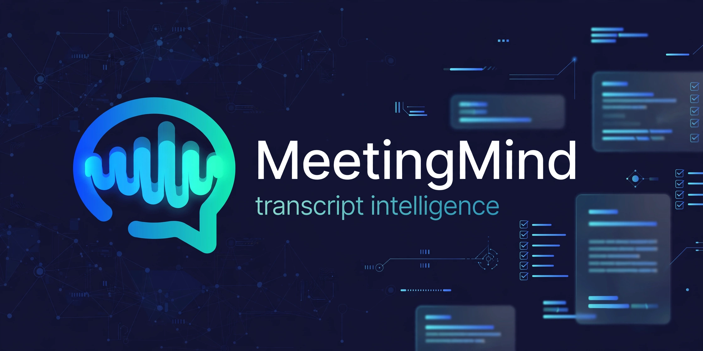
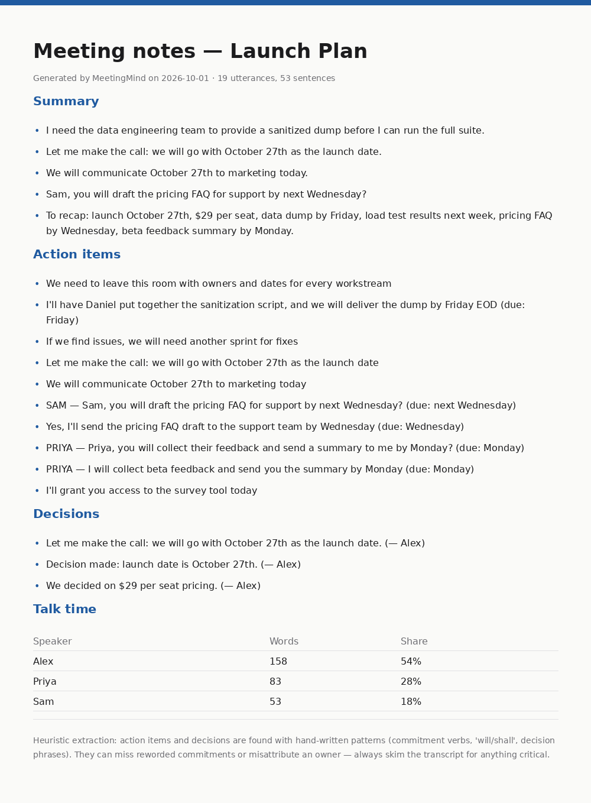
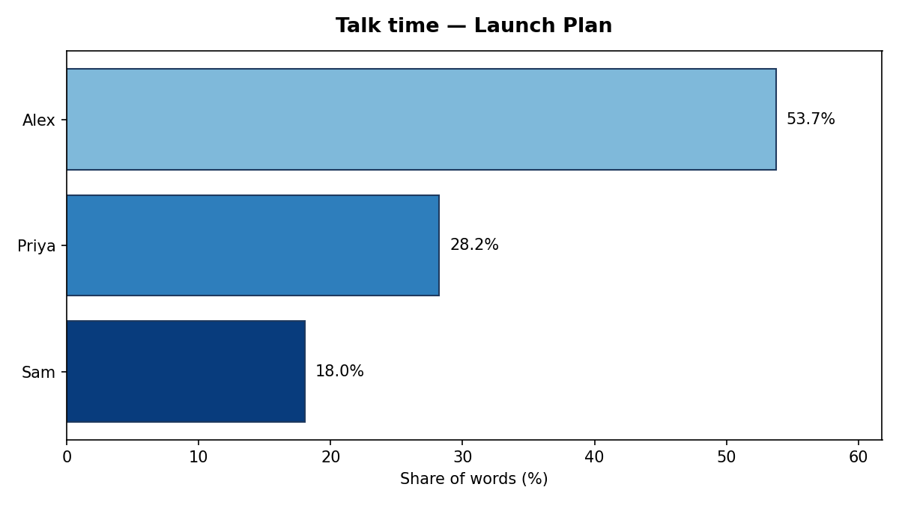

# MeetingMind — transcript intelligence

[](https://www.python.org/)
[](LICENSE)
[](#testing)
[](#quickstart)

Turn raw meeting transcripts into structured notes — **extractive summaries, action items, decisions, and talk-time stats** — with NLP built from scratch. No APIs, no keys, no network. Everything runs offline on your machine.

## Features

- **Extractive summarization** — TextRank-lite implemented from scratch: sentences become nodes in a similarity graph, PageRank scores them, and the top sentences are returned in document order.
- **Action-item extraction** — heuristic detection of commitments (`will`/`shall`/`need to`/imperatives), with assignee resolution (`"Alex will …"`, `"I will …"` → speaker, `"Sam, you will …"` → Sam) and due-date phrases (`by Friday`, `by next Wednesday`).
- **Decision detection** — catches phrasing like *"we decided"*, *"agreed"*, *"let's go with"*, *"decision made"*.
- **Speaker talk-time stats** — word counts and share per speaker, plus a matplotlib bar chart.
- **Markdown meeting notes** — one clean notes file per transcript: summary + action items + decisions + talk-time table.
- **CLI** — `summarize`, `notes`, and `demo` (end-to-end over bundled transcripts).

> **Honest caveat:** action items and decisions are found with hand-written heuristics, not ML. They reliably catch common meeting phrasing but can miss reworded commitments or misattribute an owner. The generated notes say this too — always skim the transcript for anything critical.

## Screenshots

Generated meeting notes (rendered from real output):



Talk-time chart (real output for the launch-plan transcript):



## Quickstart

```bash
git clone https://github.com/872000/meetingmind.git
cd meetingmind
pip install -r requirements.txt

# Print a 5-sentence extractive summary of a transcript
python -m meetingmind.cli summarize transcripts/launch-plan.txt

# Generate Markdown notes + talk-time chart PNG
python -m meetingmind.cli notes transcripts/launch-plan.txt --out demo-output

# End-to-end: process all 3 bundled transcripts
python -m meetingmind.cli demo
```

Transcript format is simple — speaker labels with optional timestamps:

```text
[00:00:05] ALEX: Good morning everyone, thanks for joining.
[00:01:12] PRIYA: From engineering, the dashboard backend is basically done.
```

## Example output

`notes` produces Markdown like this (from `transcripts/launch-plan.txt`):

```markdown
## Action items
- **PRIYA** — I will collect beta feedback and send you the summary by Monday (due: Monday)
- **SAM** — Sam, you will draft the pricing FAQ for support by next Wednesday? (due: next Wednesday)

## Decisions
- Let me make the call: we will go with October 27th as the launch date. (— Alex)
- We decided on $29 per seat pricing. (— Alex)
```

## Tech stack

| Piece | How it's built |
|---|---|
| Summarization | **TextRank** from scratch: TF vectors → cosine similarity graph → PageRank (`meetingmind/nlp.py`) |
| Information extraction | **Heuristic IE**: regex + rule-based patterns for commitments, assignees, due dates, decision phrases (`meetingmind/extract.py`) |
| Charts | matplotlib (only third-party dependency) |
| CLI | argparse (`meetingmind/cli.py`) |
| Tests | pytest, 9 tests (`tests/`) |

Everything except matplotlib is Python standard library. Zero network calls, zero API keys — by design.

## Project structure

```text
meetingmind/
├── meetingmind/
│   ├── __init__.py      # package version
│   ├── nlp.py           # TextRank-lite: tokenize, TF vectors, cosine sim, PageRank
│   ├── extract.py       # transcript parsing, action items, decisions, talk time
│   ├── notes.py         # Markdown rendering + talk-time chart
│   └── cli.py           # summarize / notes / demo commands
├── transcripts/         # 3 bundled sample meetings (launch-plan, sprint-retro, budget-review)
├── tests/               # pytest suite
├── tools/               # dev helpers (notes preview renderer)
├── assets/              # hero banner, sample chart, notes screenshot
├── demo-output/         # generated by `demo` (git-ignored)
├── requirements.txt     # matplotlib pinned; stdlib otherwise
└── README.md
```

## Testing

```bash
python -m pytest -v
```

Covers: TextRank picks key sentences on a tiny transcript, the action-item regex catches `"Alex will send the report"` (assignee + due date), decisions are detected, talk-time shares sum to 1, and empty inputs don't crash.

## Roadmap

- [ ] Abstractive-style "key topics" via keyword co-occurrence (still from scratch)
- [ ] Speaker diarization-friendly input (accept `.srt`/`.vtt`)
- [ ] Confidence scores on extracted action items
- [ ] Export notes to HTML
- [ ] Multi-language stopword lists

## License

MIT — see [LICENSE](LICENSE).
